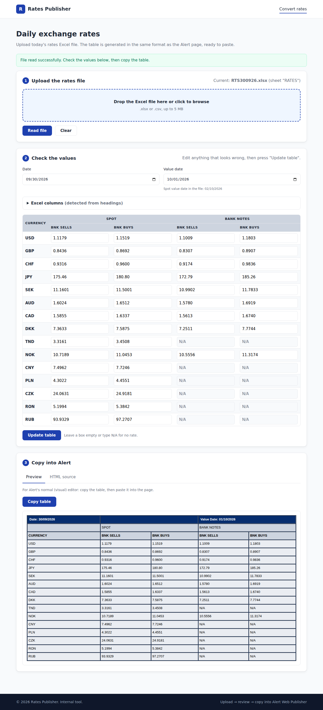

# Rates Publisher — User Guide

**Audience:** the person who updates the exchange rates on the website each day.
**Version:** 1.0 (30 September 2026)

Related documents: [Operator guide](OPERATOR.md) · [Technical documentation](TECHNICAL.md)

---

## What this tool does

Each morning you receive the rates Excel file (for example `RTS300926.xlsx`). This tool reads it and builds the exchange-rates table for the website in the same format as the one on Alert Web Publisher. You check it, copy it, and paste it into Alert. You no longer type the 60 rates by hand.

It takes about a minute.

---

## Before you start

- Open the tool in your browser: **http://localhost/rates-publisher/** (or the bookmark you were given).
- Have today's rates Excel file saved on your computer.
- Log in to Alert Web Publisher and open the exchange-rates page in edit mode.

---

## Daily steps

### Step 1 — Upload the file

1. Drag today's Excel file onto the dashed box, **or** click the box and choose the file.
2. If you clicked, press **Read file**. (Dragging the file reads it straight away.)
3. A green message appears: *File read successfully*.

Next to the step 1 heading you can see which file and sheet were read (e.g. `RTS300926.xlsx (sheet "RATES")`).

### Step 2 — Check the values

The table in step 2 shows every rate that will be published.

1. **Check the dates.**
   - **Date** is taken from the Excel file.
   - **Value date** is the next working day. The file's own spot value date is shown underneath in small grey text when it is different. If the next day is a public holiday, change the value date by hand.
2. **Check for yellow warnings** above step 2. Normally there are none. See [Warnings](#warnings) if there are.
3. **Spot-check a few rates** against the Excel file, e.g. USD and JPY. Values are rounded to 4 decimals (JPY to 2), exactly as Excel shows them.
4. **N/A** (greyed boxes) means the bank has no rate for that currency, normally bank notes for TND, CNY, PLN, CZK, RON and RUB.
5. **To change a value**, click in its box and type the new number. A comma or a dot both work (`1,1179` or `1.1179`). Leave the box empty or type `N/A` for no rate.
6. If you changed anything, press **Update table**. The table in step 3 updates.

### Step 3 — Copy into Alert

There are two ways, depending on how you edit the page in Alert.

**A. Alert's normal editor (you see the table, not code)**

1. On the **Preview** tab, press **Copy table**. "Copied ✓" appears.
2. In Alert, select the whole old rates table and delete it.
3. Click where the table was and paste (**Ctrl+V**).
4. Check it looks the same as before, then save / publish the page.

**B. Alert's Source / HTML view (you see code)**

1. Click the **HTML source** tab and press **Copy HTML**.
2. In Alert, switch the editor to **Source** (usually a `<>` or "Source" button).
3. Select the whole old rates block and delete it: from the `

` just before the rates `<table` down to the `</table>` of the small empty table after it. If the source contains nothing else, press **Ctrl+A** to select it all.
4. Paste (**Ctrl+V**) in its place.
5. Switch back to the normal view, check it, then save / publish.

### Step 4 — Check the live page

Open the public page and check the date and a couple of rates.

When you are done you can close the tool or press **Clear**. Nothing is saved; tomorrow you start again from step 1.

---

## Warnings

Yellow boxes appear above step 2 when something needs your attention.

| Warning | What it means | What to do |
|---|---|---|
| *Not found in the file (shown as N/A): XXX* | A currency on the website is not in today's file. | Check the Excel file. If the rate is there under another name, type it in by hand. Otherwise publish with N/A or ask the operator. |
| *Some columns could not be detected* | The layout of the Excel file changed. | Open **Excel columns** (below the dates) and pick the right column for each value. Each option shows the value of the first currency in the file (normally USD) in that column to help you. |
| *No BUY/SELL headings were found, so columns were assigned by position* | The headings in the Excel file changed. | Open **Excel columns** and make sure each value comes from the right column. |
| *No date was found in the file, so today's date was used* | The file's date cell was empty or unreadable. | Check the **Date** field and correct it if needed. |

### Excel columns

This section (closed by default) shows which Excel column each value comes from. For the normal file:

| Value | Excel column |
|---|---|
| Spot – Bank Sells | G |
| Spot – Bank Buys | H |
| Bank Notes – Bank Sells | I |
| Bank Notes – Bank Buys | J |

If you change a column and press **Update table**, all values are read again from the file. Any values you typed by hand are replaced, so fix columns first and hand-edit afterwards.

---

## Error messages

Red boxes mean the file could not be read. Nothing is changed.

| Message | What to do |
|---|---|
| *Please choose the rates Excel file first.* | Select a file before pressing Read file. |
| *Old .xls format is not supported…* | Open the file in Excel → **File → Save As** → type *Excel Workbook (.xlsx)* → upload the new file. |
| *Unsupported file type…* | Upload the Excel file (.xlsx), not a PDF or email. |
| *The file is not a valid .xlsx workbook.* | The file may be damaged. Download it again from the email and retry. |
| *No currency codes … were found in the file.* | This is not the rates file, or it is empty. Check you picked the right file. |
| *Your session expired. Please try again.* | Upload the file again. |
| Anything else | Tell the operator; see the [Operator guide](OPERATOR.md#10-troubleshooting). |

---

## Questions

**Does the tool publish to the website by itself?**
No. It only prepares the table. You still paste it into Alert and publish it.

**Is the Excel file stored anywhere?**
No. It is read and thrown away. Only the result is kept, on the server in your session, until you press Clear, upload another file, or the session expires (after about 24 minutes without using the page).

**Why is the value date different from the one in the Excel file?**
The website shows the next working day as the value date, which is what was published before this tool existed. The file's spot value date (normally two working days later) is shown under the field. If the published value date should follow the file, ask the operator to change the setting.

**Why does JPY have only 2 decimals?**
That is how it is shown on the website and in the Excel file.

**The Copy button says "Copy failed".**
Select the table in the Preview with the mouse (or click in the HTML box and press Ctrl+A) and press Ctrl+C.

**I pasted and the table looks different in Alert.**
Try the other method (Source/HTML view). Pasting the HTML into the source view always gives exactly the original layout.

**Can I use it on my phone?**
Yes, the page works on small screens, but copying into Alert is easier on a computer.
